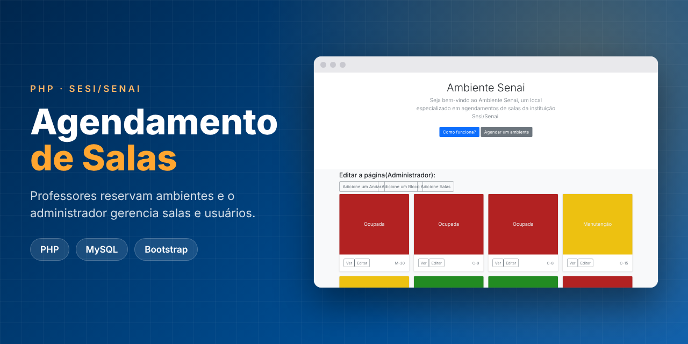

<p align="center">
  
</p>

<h1 align="center">🗓️ Agendamento de Salas (SENAI)</h1>

<p align="center">
  Portal web em <b>PHP</b> e <b>MySQL</b> para reservar salas e laboratórios da rede <b>SESI/SENAI</b>, com
  painel do <b>administrador</b> para cadastrar ambientes e liberar o acesso dos usuários.
</p>

<p align="center">
  
  
  
  
  
</p>

<p align="center">
  <a href="#-sobre-o-projeto">Sobre</a> •
  <a href="#-funcionalidades">Funcionalidades</a> •
  <a href="#️-telas">Telas</a> •
  <a href="#-como-executar">Como executar</a> •
  <a href="#️-banco-de-dados">Banco de dados</a> •
  <a href="#-estrutura-do-projeto">Estrutura</a> •
  <a href="#️-tecnologias">Tecnologias</a>
</p>

---

## 📌 Sobre o projeto

O **Agendamento de Salas** é um portal desenvolvido para ajudar na gestão dos ambientes educacionais e laboratórios
da rede **SESI/SENAI**.

Construído em PHP com banco de dados MySQL, o sistema tem uma interface web responsiva (Bootstrap) em que os
professores veem as salas cadastradas e reservam as que estão disponíveis. O administrador tem um painel para criar e
editar ambientes e para aprovar as contas recém-cadastradas.

O projeto foi uma oportunidade para aplicar conceitos de back-end: **CRUD**, **relacionamento entre tabelas**
(salas × andares × blocos) e **sessões** para autenticação e páginas protegidas.

## ✨ Funcionalidades

### 👨‍🏫 Professor (usuário geral)

| | Recurso | Descrição |
|---|---|---|
| 📝 | **Cadastro** | Nome, e-mail, senha e instituição (SESI, SENAI ou outros); a conta fica pendente até ser aprovada |
| 🔐 | **Login** | Acesso liberado só para contas aprovadas (senha guardada em MD5) |
| 🏫 | **Salas em cards** | Todas as salas com cor por status: 🟩 Disponível, 🟥 Ocupada e 🟨 Manutenção |
| 🔎 | **Detalhes da sala** | Descrição, bloco, andar e, se estiver ocupada, data e horário da reserva |
| 📅 | **Agendamento** | Salas disponíveis podem ser reservadas informando data, hora inicial e hora final |
| 👤 | **Perfil** | Janela com os dados da conta e o botão para sair |

### 🛡️ Administrador

| | Recurso | Descrição |
|---|---|---|
| ➕ | **Ambientes** | Cadastro de andares, blocos e salas (com status, andar e bloco) |
| ✏️ | **Edição de salas** | Altera nome, descrição e status ou exclui a sala |
| ✅ | **Validação de contas** | Lista de usuários não validados para aprovar ou excluir |
| 👥 | **Todos os usuários** | Validar, invalidar, editar (incluindo o nível de acesso) e excluir usuários |

## 🖼️ Telas

<table>
  <tr>
    <td align="center"><b>Cadastro</b><br></td>
    <td align="center"><b>Login</b><br></td>
  </tr>
  <tr>
    <td align="center"><b>Salas (administrador)</b><br></td>
    <td align="center"><b>Salas (professor)</b><br></td>
  </tr>
  <tr>
    <td align="center"><b>Agendar uma sala</b><br></td>
    <td align="center"><b>Detalhes da sala</b><br></td>
  </tr>
  <tr>
    <td align="center"><b>Editar sala</b><br></td>
    <td align="center"><b>Adicionar sala</b><br></td>
  </tr>
  <tr>
    <td align="center"><b>Usuários não validados</b><br></td>
    <td align="center"><b>Todos os usuários</b><br></td>
  </tr>
</table>

> Na pasta [`ImagensGit`](ImagensGit) estão as demais telas (perfil, adicionar andar e adicionar bloco).

## 🚀 Como executar

### Com XAMPP (ou WAMP/Laragon)

1. Inicie o **Apache** e o **MySQL**.
2. Clone o repositório dentro do `htdocs`:
   ```bash
   git clone https://github.com/kauaxp77/Agendamento-de-Salas.git
   ```
3. No phpMyAdmin (`http://localhost/phpmyadmin/`), crie o banco **`ambientes`** e importe o
   [`ambientes.sql`](ambientes.sql), que cria as tabelas e os dados de teste.
4. Acesse `http://localhost/Agendamento-de-Salas/agendamento/login.php`.

### Com o servidor embutido do PHP

```bash
mysql -u root -e "CREATE DATABASE ambientes"
mysql -u root ambientes < ambientes.sql
php -d output_buffering=4096 -S localhost:8000
```

Acesse `http://localhost:8000/agendamento/login.php`. O `output_buffering` evita o erro de cabeçalho já enviado nos
redirecionamentos (no XAMPP ele já vem ligado no `php.ini`).

A conexão fica em `agendamento/system/config.php` (`localhost`, usuário `root`, senha vazia, banco `ambientes`).

> **Credenciais de teste** (senha `123`):
> * Administrador: `adm@gmail.com`
> * Professor: `Usuario@gmail.com`
>
> Ou crie uma conta em **Cadastre-se** e aprove-a pelo administrador.

## 🗄️ Banco de dados

| Tabela | Função |
|---|---|
| `tb_usuarios` | Usuários, instituição e nível (`0` pendente, `1` professor, `2` administrador) |
| `tb_salas` | Salas, descrição, status (`1` disponível, `2` ocupada, `3` manutenção) e dados da reserva |
| `tb_andar` | Andares |
| `tb_bloco` | Blocos e descrição |
| `tb_pc` | Tabela auxiliar (ainda sem uso nas telas) |

As salas referenciam andar e bloco com chaves estrangeiras `ON DELETE CASCADE`.

## 📁 Estrutura do projeto

```
Agendamento-de-Salas/
├── agendamento/
│   ├── login.php           # Login
│   ├── cadastro.php        # Cadastro de usuário
│   ├── paginicial.php      # Página inicial: salas, agendamento e painel do administrador
│   ├── administrador.php   # Usuários aguardando validação
│   ├── todosusuarios.php   # Todos os usuários
│   ├── editar.php          # Edição de usuário
│   ├── sobre.html          # Página "Como funciona?"
│   ├── system/             # config.php e conexao.php (conexão com o MySQL)
│   └── assets/             # CSS e imagens
├── ImagensGit/             # Capturas de tela usadas neste README
├── docs/                   # Banner deste README
└── ambientes.sql           # Script do banco com dados de teste
```

## 🛠️ Tecnologias

- **Front-end:** HTML5, CSS3 e Bootstrap 5 (modais e grid responsivo)
- **Back-end:** PHP com `mysqli` e sessões
- **Banco de dados:** MySQL
- **Ambiente:** XAMPP (Apache + MySQL) e phpMyAdmin

## 👨‍💻 Autor

Desenvolvido por **[kauaxp77](https://github.com/kauaxp77)**

<p align="center">⭐ Se curtiu o projeto, deixe uma estrela!</p>
